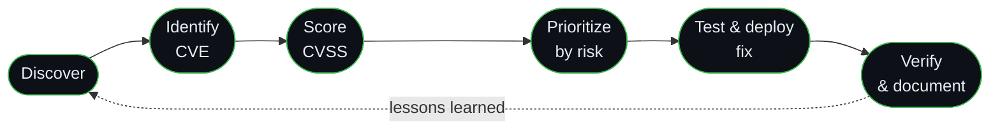

<!-- GitHub profile README · Ossy-sec -->

<div align="center">


<br/>

<a href="https://wondrous-begonia-3a3db2.netlify.app/"></a>
<a href="https://www.linkedin.com/in/osman-said-ab0a87339"></a>
<a href="https://github.com/Ossy-sec"></a>
<a href="mailto:osmansaid0707@gmail.com"></a>

<br/><br/>


</div>


## 🧬 &nbsp;About Me

```python
class OsmanSaid:
    role      = "Cybersecurity student & researcher"
    studying  = "B.Sc. (Hons.) CS with Cyber Security, Galgotias University (2024 – 2027)"
    background = "Web development → application security"
    focus     = ["Web app security", "Vulnerability assessment",
                 "SOC alert triage & incident response", "Python security tooling"]
    learning  = ["Secure code review", "Web pentesting",
                 "Security automation", "AI governance & responsible AI"]
    languages = ["Somali (native)", "English (advanced)",
                 "Arabic (conversational)", "Kiswahili (conversational)"]
    motto     = "Learn continuously. Test ethically. Build securely."
```

My background in web development drives my focus on application security: understanding how software is built, where it fails, and how to make it more resilient. I also write cybersecurity research and write-ups on Medium, including phishing awareness.

> [!NOTE]
> 🤝 **Open to** cybersecurity internships, junior security roles and open-source collaboration.

<br/>

## 📊 &nbsp;GitHub Stats

<div align="center">


</div>

<br/>

## 🛠️ &nbsp;Tech Stack

<table>
<tr>
<td width="170"><b>🔐 Security Tools</b></td>
<td>


</td>
</tr>
<tr>
<td><b>💻 Languages & Web</b></td>
<td>

</td>
</tr>
<tr>
<td><b>⚙️ Backend & DevOps</b></td>
<td>

</td>
</tr>
<tr>
<td><b>🤖 AI Tools</b></td>
<td>


</td>
</tr>
<tr>
<td><b>🎨 Design</b></td>
<td>

</td>
</tr>
</table>

<br/>

## 🚀 &nbsp;Featured Projects

| Project | Description | Status |
|:--|:--|:--:|
| 🧠 **Secure Code Analysis SaaS** | AI-assisted code review, quality analysis, vulnerability detection, review suggestions and downloadable security reports |  |
| 🧩 **Microservices Architecture** | Major group project: a task management platform where users create projects, assign tasks, track progress and manage team activity through independent microservices (Java, Spring Boot, Kafka, Docker) |  |
| 🛡️ **SOC-L1-Alert-Triage** | Alert analysis and investigation of suspicious activity: classifying true and false positives, assessing severity and documenting findings following SOC L1 workflows |  |
| 🎣 **Phishing Email Detector** | Browser-based tool that analyzes email content for phishing indicators: suspicious links, sender mismatches, authentication failures and requests for sensitive information |  |
| 🔍 **Web App Vulnerability Assessment** | Controlled lab assessment using Nikto: identifying issues, mapping findings to the OWASP Top 10, documenting proof-of-concepts and writing a prioritized remediation report |  |
| 🔑 **Password Strength Checker** | Python CLI that scores passwords against common security criteria |  |

<sub>Repository links will be added as each project is published.</sub>

<br/>

## 🔄 &nbsp;How I Approach Vulnerabilities

Finding a vulnerability is only the beginning. My lab and research work follows the full lifecycle:



<br/>

## 💼 &nbsp;Experience

| | |
|:--|:--|
| **Major Project Leader** · Galgotias University<br/><sub>Greater Noida, India · 2026 – Present</sub> | • Led a team of students building a project on Microservices Architecture for Scalable Applications, coordinating planning and development<br/>• Coordinated system design, task distribution and implementation to improve identity verification and application security |
| **Security Analyst Intern** · Oasis Infobyte (OIBSIP)<br/><sub>Delhi, India · Aug – Sep 2026</sub> | • Researched social engineering and the patch and vulnerability management lifecycle (CVE, CVSS, risk-based prioritization), including WannaCry/EternalBlue and the Equifax breach<br/>• Ran a Nikto scan against a local DVWA environment, categorized the findings and documented remediation recommendations with evidence screenshots<br/>• Performed SQL injection testing and database enumeration in a controlled DVWA lab, documenting steps, impact and mitigations<br/>• Tools: Kali Linux, Burp Suite, Nikto, SQL, Bash, GitHub |
| **CTF Player** · Hack The Box & TryHackMe<br/><sub>2025 – Present</sub> | • Authorized challenges covering web security, vulnerability discovery and privilege escalation |
| **Graphic Designer** · Duwan Studio<br/><sub>Garowe, Somalia · 2024 – 2026</sub> | • Created logos, social media graphics and other visual designs in Adobe Photoshop based on client needs |
| **Freelance Web Developer & Designer**<br/><sub>2023 – 2025</sub> | • Built responsive websites and design assets with a secure-by-design mindset |

<br/>

## 🎓 &nbsp;Education

**B.Sc. (Hons.) Computer Science with Cyber Security** · Galgotias University, India · *2024 – 2027*
- Coursework: Network Security, Cryptography, Web Application Security, Risk Management, Ethical Hacking
- Active member of university CTF and security-lab activities

<br/>

## 🏅 &nbsp;Certifications

<div align="center">


</div>

<details>
<summary><b>View all certifications with dates</b></summary>

<br/>

| Certification | Issuer | Issued |
|:--|:--|:--|
| Google Cybersecurity Professional Certificate | Google | Sep 2026 |
| IBM Generative AI Essentials | IBM | Sep 2026 |
| Generative AI for Cybersecurity Professionals | IBM | |
| AI and Digital Transformation in Government | University of Oxford / UNESCO | 2026 |
| Security Management and Governance | Royal Holloway, University of London | Aug 2026 |
| Network Defense | Cisco Networking Academy | Aug 2026 |
| Practical Bug Bounty | TCM Security | Jul 2026 |
| Vulnerability Scanning with Nmap: Network Scanning | Coursera | Jul 2026 |
| Python Essentials 1 | Cisco Networking Academy | Jun 2026 |
| Junior Cybersecurity Analyst Career Path | Cisco Networking Academy | May 2026 |
| Digital Footprint | Internet Society | May 2026 |
| Network Security and Protection | Google | Feb 2026 |
| Wireshark for Beginners: TCP/IP Protocol Fundamentals | Coursera | Feb 2026 |
| Deloitte Australia Cyber Job Simulation | Forage | Sep 2025 |
| Certified Web Red Team Analyst (WEB-RTA) | CyberWarFare Labs | 2026 |

</details>

<br/>

## 🎯 &nbsp;Training Platforms

<div align="center">


</div>

<br/>


<div align="center">

<br/>


<sub>All security testing is performed in authorized labs or environments where explicit permission has been granted.</sub>


</div>
